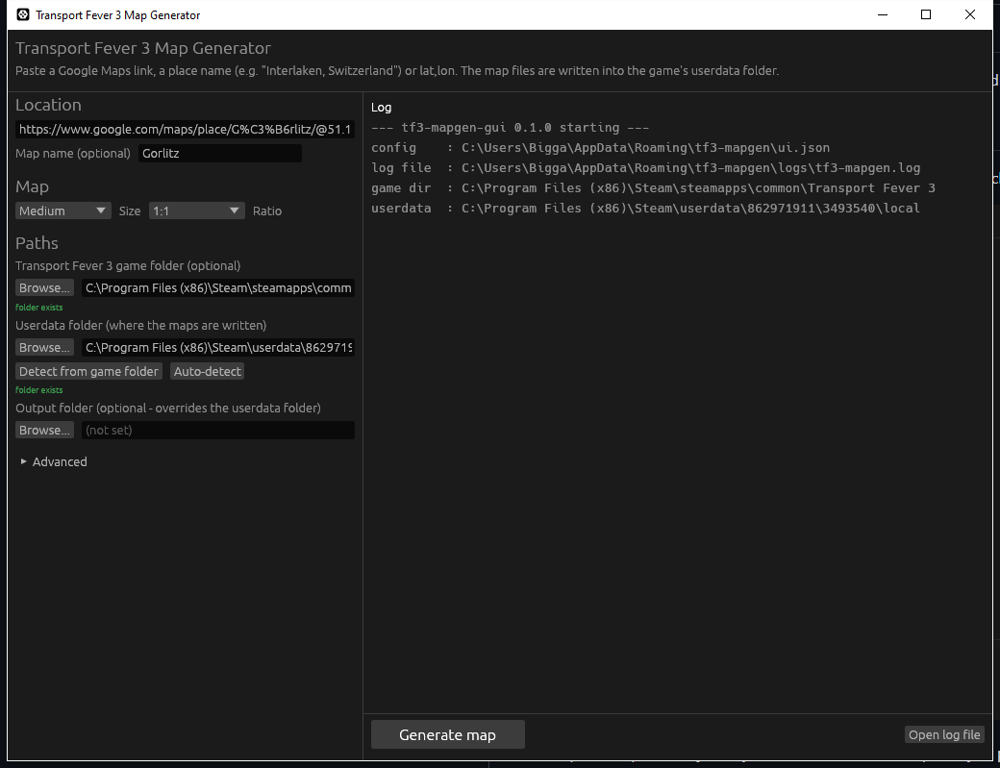

# tf3-mapgen

Rust tool that turns a real-world location into a **Transport Fever 3** map:
terrain height, bodies of water, vegetation masks and town positions, ready to
import with the game's built-in **Map Editor**.

Give it a Google Maps URL (or a place name / coordinates) and it writes:

| Output | Goes to (userdata) | Imported in the Map Editor as |
|---|---|---|
| `<name>.png` | `heightmaps/` | 16-bit grayscale heightmap (Min/Max Height, Water Level) |
| `<name>_rivers.png` | `biomes/` | "Rivers" biome layer mask (river vegetation + sounds) |
| `<name>_mountains.png` | `biomes/` | "Mountains" biome layer mask (conifer/alpine vegetation) |
| `<name>_biomes.png` | `biomes/` | Biomes mask (experimental, see caveats) |
| `<name>.lua` | `towns_industries/` | Town positions (the game builds the houses) |
| `settings.txt`, `preview.png`, `metadata.json` | `tf3_mapgen/<name>/` | Reference / visual check |

The game then generates the actual vegetation (trees/rocks) and house
buildings procedurally from these inputs - based on the real geography in the
heightmap and masks.



> New here? See **[TUTORIAL.md](TUTORIAL.md)** for a short step-by-step walkthrough.

## One-click app (GUI)

`target\release\tf3-mapgen-gui.exe` is a native desktop app - double-click it.

1. Paste a location (Google Maps link, `Interlaken, Switzerland`, or `lat,lon`).
2. (Optional, once) Set the **Game folder** and **Userdata folder** under
   *Paths*. Both are auto-detected, but every path is editable:
   - **Game folder**: e.g. `C:\Program Files (x86)\Steam\steamapps\common\Transport Fever 3`
   - **Userdata folder**: where the files are written, e.g.
     `C:\Program Files (x86)\Steam\userdata\<id>\3493540\local`
   - **Output folder** (optional): write everything somewhere else instead.
3. Pick size/ratio (default Medium 1:1).
4. Click **Generate map**.
5. Use the buttons to open the heightmaps folder, the preview or `settings.txt`,
   then import in the game (steps below). The preview is shown in the window.

The GUI remembers all settings in `%APPDATA%\tf3-mapgen\ui.json`.

### Logs and error reporting

The GUI has no console window, so everything is logged instead:

- Every run is written to `%APPDATA%\tf3-mapgen\logs\tf3-mapgen.log`
  (timestamped, includes startup paths and every progress/error line).
- If generation fails, an **error dialog** appears with *Copy error*,
  *Open log file* and *Close* buttons.
- If the app ever crashes (panic), it writes the crash to the log **and**
  shows a message box pointing at the log file.
- **Open log file** in the bottom bar opens the log at any time.

When reporting a problem, send `tf3-mapgen.log` - it contains the paths and the
exact error.

The config/log locations can be overridden with the `TF3_MAPGEN_CONFIG` and
`TF3_MAPGEN_LOG` environment variables (useful for portable installs).

## CLI usage

```
# Google Maps URL (copy it straight from your browser)
tf3-mapgen "https://www.google.com/maps/@46.6863,7.8632,13z" --size medium

# Place name (geocoded with Nominatim)
tf3-mapgen "Interlaken, Switzerland" --size medium

# Coordinates
tf3-mapgen --lat 48.8584 --lon 2.2945 --name "Paris" --size large

# Custom paths
tf3-mapgen "Lake Como" --game-dir "C:\Program Files (x86)\Steam\steamapps\common\Transport Fever 3"
tf3-mapgen "Lake Como" --userdata "C:\...\steamapps\userdata\123\3493540\local"
tf3-mapgen "Lake Como" --out .\output

# See where the game data folder was detected
tf3-mapgen --print-userdata
```

The exact pixel size per size/ratio is taken from the official table:

https://wiki.transportfever3.com/doku.php?id=gamemanual:mapsizes

### Options

| Option | Description |
|---|---|
| `--name <NAME>` | Output map name (file names + town file) |
| `--size <SIZE>` | `tiny, small, medium, large, verylarge, huge, megalomaniac, gigantomaniac` |
| `--ratio <R>` | `1:1, 1:2, 1:3, 1:4, 1:5` |
| `--water-level <M>` | Override the auto-detected water level |
| `--min-height <M>` / `--max-height <M>` | Override the height range written into the settings |
| `--sea-depth <M>` | How deep seas are carved below the water level (default 60) |
| `--zoom <8-15>` | Elevation tile zoom (default: automatic, max 15 = dataset limit) |
| `--max-towns <N>` | Cap the number of towns (default: scaled with map area) |
| `--skip-osm` | Terrain only - no inland water, forests or towns |
| `--no-seam-repair` | Disable the automatic repair of elevation data seams/outliers |
| `--osm-endpoint <URL>` | Use a specific Overpass API endpoint |
| `--game-dir <DIR>` | Game installation folder (used to locate userdata) |
| `--userdata <DIR>` | Userdata folder (where maps are written) |
| `--flip-x` / `--flip-y` | Mirror the map (see Orientation below) |
| `--out <DIR>` | Write outputs here instead of the userdata folder |
| `--print-userdata` | Print the detected userdata folder and exit |

## Testing it (first run, ~5 minutes)

1. **Build once**: `cargo build --release` (Rust must be installed).
2. **Generate**: run `target\release\tf3-mapgen-gui.exe`, paste
   `Interlaken, Switzerland` (or any Google Maps link), click **Generate map**.
   A preview appears and files are written to the userdata folder. If you do
   not want anything written to the game folders yet, set **Output folder** to
   a scratch directory first.
3. **Import in the game**:
   1. Transport Fever 3 -> **Map Editor** -> **New Map** -> climate
      `Temperate`, size/ratio as shown in the log (Medium 1:1 for the default).
      Experimental sizes require `experimentalMapFeatures = true` in
      `settings.lua`.
   2. **Heightmap** tool -> **Import** tab -> select the generated `.png` ->
      enter the exact **Min Height / Max Height / Water Level** from the log
      ("settings.txt" has them too) -> **Import**.
   3. *(optional)* **Biomes** tab -> select `<name>_rivers.png`,
      `<name>_mountains.png` -> **Apply**. Add `<name>_biomes.png` if you want
      to test the experimental biome mask.
   4. **Towns & Industries** -> **Import** tab -> select `<name>.lua` ->
      **Import** (towns appear at the real settlement positions).
   5. **Street connections** tool -> **Propose Default Connections** ->
      **Generate**.
4. Check the result: lakes/rivers should be at the right place, mountains
   should match the real terrain, and the town names should be the real names.
5. If the map is **mirrored** (compare with the preview image): regenerate with
   **Flip north/south** (and/or east/west) in the Advanced section.

## Import workflow details (verified against the official game manual)

- Heightmaps: grayscale PNG, 4 m per pixel, sizes from the official table.
- `biomes/` masks are grayscale; the biomes mask divides 0-100% into equal
  intervals (5 biomes -> 0.1, 0.3, 0.5, 0.7, 0.9), other masks are black/white.
- `towns_industries/` files are Lua tables with `position = {x, y}` in meters,
  centered on the map (0,0).
- The climate's import generator turns the heightmap + masks into terrain
  materials and vegetation, so no game files need to be modified.

## How it works

- **Terrain**: AWS Terrarium tiles (elevation encoded in RGB) are fetched in
  parallel, mosaicked, resampled to the exact 4 m/pixel grid of the target map
  size, and written as 16-bit grayscale PNG.
- **Seam repair**: elevation datasets contain occasional straight artificial
  trenches/cliffs (data seams between source datasets). The tool detects
  narrow straight anomalies and interpolates them away (a warning reports how
  many pixels were repaired). Disable with `--no-seam-repair` or the GUI
  checkbox if you want the raw data.
- **Water**: OpenStreetMap water polygons, multipolygon relations (outer rings
  are stitched back together), river/canal centerlines and the connected
  "sea" (flood-fill of `elevation <= 0` from the map border) are rasterized.
- **Single water plane**: Transport Fever has one global water level, so the
  tool auto-detects it from the *shoreline* of the largest water body (0 m if
  the map has a sea, e.g. 182 m for Gorlitz's Neisse). Only water features
  within 80 m of that level are carved - so alpine streams don't become
  bottomless cracks. Use `--water-level` to override.
- **Vegetation masks**: OSM forests become biome 1 (forest), high/steep terrain
  biome 3/4, water biome 0, everything else biome 2. The rivers/mountains
  masks are black/white layers the TF3 import generator uses to place river and
  mountain vegetation. Slopes for the mountains mask are computed on a
  smoothed terrain so flat plains stay black.
- **Towns**: OSM `place=city|town|village|hamlet` nodes are converted to
  `towns_industries` Lua with size factors from population, deduplicated and
  capped by map area.

## Caveats (read these)

- **Orientation is not yet verified in-game.** The tool assumes *north at the
  top* (image row 0 = north) and writes town coordinates with the matching
  convention. Open `preview.png` after generating: if the in-game import shows
  a mirrored map, regenerate with `--flip-y` (and/or `--flip-x`, or the check
  boxes in the GUI). Terrain and town positions always stay consistent with
  each other.
- **`<name>_biomes.png` is experimental.** The mapping of OSM land cover to
  the 5 climate biomes is a best-effort guess (the biomes are only labeled
  "Biome 0..4" in the game data). Try importing with and without it.
- **Water level**: values other than 0 work, but the game manual recommends
  aiming for 0 "for the best results with the biomes and materials". Coastal
  maps automatically use 0. If you want to force sea level on an inland map,
  pass `--water-level 0` (high lakes then stay as land).
- **No industry positions** are generated (OSM landuse tags don't map reliably
  to game industries). Use the in-game industry generator, or place them
  manually.
- Very large maps (Huge and up) need a lot of RAM/CPU in the game itself.

## Development

```
cargo test            # unit tests + GUI tests (egui_kittest); 36 tests
cargo test -- --ignored   # full network end-to-end through the GUI
cargo clippy          # lint
cargo fmt
cargo build --release # builds both the CLI and the GUI
```

## Data sources & attribution

- Elevation: [AWS Open Data Terrain Tiles](https://registry.opendata.aws/terrain-tiles/) (Mapzen Terrarium), SRTM/other DEMs.
- Water, forests, settlements: © [OpenStreetMap contributors](https://www.openstreetmap.org/copyright) via the Overpass API.
- Geocoding: Nominatim (OSM).

Please respect the usage policies of the Overpass/Nominatim services when
generating many maps.
